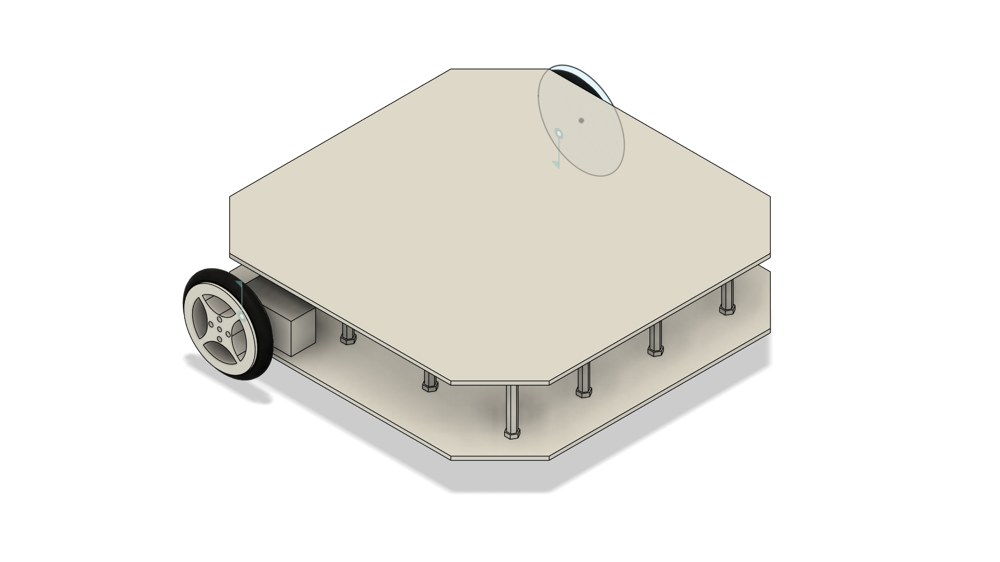

# testbot — Robot Description



Two-wheel differential-drive robot with a ball caster. Modelled in
Fusion 360, exported with
[fusion2URDF](https://github.com/Adriaeik/fusion2URDF) v3.1.1, then
corrected by hand for simulation.

> **Which files are generated and which are hand-written** is the first
> thing to know about this package. See [Provenance](#provenance).

## Overview

| Property | Value | Source |
|----------|-------|--------|
| Total mass | 0.548 kg | CAD (+2 g nominal for the two sensor links) |
| Links | 3 from CAD, +2 sensors in simulation | — |
| Joints | 2 continuous, +2 fixed in simulation | — |
| Root link | `base_link` | CAD |
| Chassis | 0.26 × 0.26 × 0.079 m | mesh bbox |
| Wheel radius | 0.035 m | mesh bbox 0.070 m across |
| Wheel width | 0.0182 m | mesh bbox |
| Wheel separation | 0.2762 m | centres at y = ±0.1381 m |
| Wheel centre height | z = +0.0155 m | joint origin |
| Ground clearance | 0.0195 m at the wheel bottom | 0.0155 − 0.035 |
| Caster | sphere r = 0.005 m at (0.09, 0, −0.018) | merged into `base_link` |
| Top speed | 1.05 m/s | 30 rad/s × 0.035 m |

Every dimension above was re-measured from the `.dae` meshes rather than
taken on trust; see [Geometry](#geometry).

## Quick start

```bash
cd ~/Documents/test_ws
source /opt/ros/humble/setup.bash
colcon build --symlink-install --packages-select testbot_description
source install/setup.bash
```

### Look at it

```bash
ros2 launch testbot_description display.launch.py
```

RViz plus `joint_state_publisher_gui`. Drag either slider and the
corresponding wheel spins about **+y** in `base_link`. Both wheels turning
the same way for a positive value is the point — see
[The mirrored-wheel bug](#1-the-mirrored-wheel-bug).

`use_gui:=false` swaps the sliders for a headless
`joint_state_publisher` that holds every joint at zero.

### Drive it

```bash
ros2 launch testbot_description sim.launch.py rviz:=true
```

Gazebo Classic with `worlds/obstacles.world`, the robot spawned as
`testbot`, then `joint_state_broadcaster` and `diff_drive_controller`
brought up in that order. Then, in another terminal:

```bash
ros2 topic pub --rate 10 /diff_drive_controller/cmd_vel_unstamped \
  geometry_msgs/msg/Twist "{linear: {x: 0.15}}"
```

or by keyboard:

```bash
ros2 run teleop_twist_keyboard teleop_twist_keyboard \
  --ros-args -r cmd_vel:=/diff_drive_controller/cmd_vel_unstamped
```

or the scripted sequence:

```bash
ros2 run testbot_description drive_demo.py --ros-args -p use_sim_time:=true
```

## Launch files

| File | What it does | Arguments |
|------|--------------|-----------|
| `rsp.launch.py` | `robot_state_publisher` only. The single place that turns the xacro into `/robot_description`. | `use_sim_time` (default `false`), `prefix` |
| `display.launch.py` | `rsp` + joint sliders + RViz. No physics, no controllers. | `use_gui` (default `true`), `prefix` |
| `sim.launch.py` | Gazebo + `rsp` + spawn + controllers, optionally RViz. | `world`, `rviz` (default `false`) |

`use_sim_time` on `rsp.launch.py` does double duty: it sets the clock
source **and** it is passed to xacro as `use_sim`, which decides whether
the Gazebo plugin and sensor blocks are emitted at all.

### Removed argument

`namespace` was dropped from `display.launch.py`. It never worked:
`PushRosNamespace` moved the topic to `/<ns>/robot_description`, but
`rviz/display.rviz` subscribes to the absolute `/robot_description`, so
the model silently vanished. `prefix` was kept — it does work — but note
that a non-empty prefix breaks **simulation**, because the joint names in
`config/ros2_controllers.yaml` are fixed strings.

## What was wrong, and what was changed

The exporter produced a geometrically faithful model that could not be
simulated. Seven separate problems:

### 1. The mirrored-wheel bug

The exporter gives every continuous joint its own local **+z** as the
rotation axis, then rotates the joint frame to suit. The left wheel's
origin `rpy` is `(−π/2, 0, 0)`, so its axis maps to **+y** in `base_link`.
The right wheel's is `(+π/2, 0, 0)`, so its axis maps to **−y**.

The same positive wheel velocity therefore drove the two wheels in
**opposite directions**: a forward `Twist` made the robot spin on the spot.

```
            BEFORE                        AFTER
  Revolute_2  axis +z -> +y in base   Revolute_2  axis +z -> +y
  Revolute_4  axis +z -> -y in base   Revolute_4  axis -z -> +y
  => wheels counter-rotate            => wheels turn together
```

Fixed by flipping the right joint's axis to `0 0 -1` in
`urdf/assemblies/testbot.urdf.xacro`.

**The better fix, which is not applied.** Setting
`Backward_Right_wheel` to `rule=world_rpy` with `post_roll_deg=-90` in
`config/frame_overrides.csv` and re-running fusion2URDF
`tools/reframe.py` corrects the *frame* instead of patching the axis, and
survives a re-export. The CSV **has been edited** to say exactly that, but
`reframe.py` needs `debug/frame_model.json` from a Fusion export run with
`include_debug=true`, and this package does not ship one. Re-export from
Fusion with debug enabled and the CSV will do the right thing.

### 2. Joint limits made the robot immobile

`<limit effort="100.0" velocity="1.00"/>` caps the wheels at 1 rad/s,
which on a 0.035 m wheel is **0.035 m/s** — slower than the minimum step
of most teleop tools, so `diff_drive_controller` saturated on essentially
any command. Raised to 30 rad/s (1.05 m/s). Effort dropped from a
meaningless 100 N·m on a 34 g wheel to 1.5 N·m.

### 3. No Gazebo hardware

The generated `<ros2_control>` block hard-coded
`mock_components/GenericSystem`. Moved to
`urdf/testbot.ros2_control.xacro`, where a `use_sim` argument selects
`gazebo_ros2_control/GazeboSystem` instead, and the
`libgazebo_ros2_control.so` plugin block was added in
`urdf/testbot.gazebo.xacro`.

### 4. Two controllers fighting over one resource

`config/ros2_controllers.yaml` declared `position_controller` **and**
`velocity_controller`, both `forward_command_controller`, both on
`[Revolute_2, Revolute_4]` — and `display.launch.py` spawned both as
active. The second to start died with a resource conflict. Neither could
have driven the robot anyway: a `forward_command_controller` takes raw
per-joint numbers, not a `Twist`.

Replaced with `joint_state_broadcaster` + `diff_drive_controller`.
A `wheel_velocity_controller` is still declared but is loaded
**inactive**, as a deliberate demonstration of that same conflict.

### 5. Collision meshes ODE cannot handle

Collision reused the visual `.dae` files. A 3982-vertex tyre gives ODE a
ragged contact patch and makes the robot buzz on the spot.

| Link | Was | Now |
|------|-----|-----|
| wheels | 3982-tri DAE | `<cylinder radius="0.035" length="0.0182"/>` at z = 0.0091 |
| `base_link` | 4813-tri DAE | `<box size="0.26 0.26 0.056"/>` at z = 0.028 + caster `<sphere radius="0.005"/>` |

### 6. The caster sits 3.5 mm too low — deliberate CAD/sim mismatch

In the CAD the caster's lowest point is z = −0.023, while the wheels
reach z = −0.0195. Modelled faithfully the robot rests nose-down on the
caster with the drive wheels barely loaded, and will not track straight.

The **collision** sphere is therefore raised 3.5 mm to centre z = −0.0145,
putting its bottom exactly level with the wheels. The **visual** mesh is
untouched, so renders still show the true CAD. This is the one place where
the simulation deliberately disagrees with the model, and it is commented
as such in the xacro.

Friction follows: wheels `mu1 = mu2 = 1.0`, `base_link` (i.e. the caster)
`mu1 = mu2 = 0.0`, because a real ball caster swivels and a frictionless
sphere is the cheap way to fake that without two extra joints.

### 7. No sensors

The CAD has none. `urdf/testbot.sensors.xacro` adds two **invented**
links, emitted only when `use_sim:=true`:

| Link | Pose in `base_link` | Geometry | Gazebo plugin | Topic |
|------|--------------------|----------|---------------|-------|
| `lidar_link` | (0, 0, 0.076) | cylinder r = 0.0375, h = 0.040 | `libgazebo_ros_ray_sensor.so` | `/scan` |
| `imu_link` | (−0.06, 0, 0.058) | box 0.025 × 0.018 × 0.004 | `libgazebo_ros_imu_sensor.so` | `/imu/data` |

The LiDAR stands on the top plate (surface z = 0.056) and is sized as an
RPLIDAR A1, matching its 0.12–3.5 m range, 360°, 10 Hz. Its scan plane at
z = 0.076 clears the chassis, so it cannot see itself. The IMU lies on the
same plate 60 mm behind centre.

**These two poses are guesses. Check them against the physical robot** —
they are `xacro:property` values at the top of the file, so they are one
line each to change.

## Four things that cost real time

All four were found by measurement while getting the simulation to pass
its acceptance tests. None of them produces a useful error message.

### 1. Named collisions silently lose their friction

Gazebo's URDF-to-SDF converter attaches a `<gazebo reference="L">`
friction block to a collision named exactly `L_collision`. Give the
collision any other name and `mu1`/`mu2`/`kp`/`kd` are **discarded with no
warning**, and the surface falls back to the ODE default of `mu = 1`.

Naming `base_link`'s two collisions `chassis_collision` and
`caster_collision` therefore threw away the `mu = 0` meant for the caster.
The caster gripped the floor as hard as the tyres, and the wheels stalled
at 1.765 rad/s against a 4.286 rad/s command — which reads exactly like a
controller fault or a torque limit, and is neither.

Leaving the `name` attribute off entirely makes the converter emit
`base_link_collision` and `base_link_collision_1`, and it recognises both.
Check what actually reached the physics engine with:

```bash
gz sdf -p /tmp/testbot_sim.urdf | grep -A6 '<collision'
```

### 2. Joint `<dynamics>` fights the velocity motor

Adding plausible-looking realism —

```xml
<dynamics damping="0.001" friction="0.001"/>
```

— cost the wheels a flat **6%** of their commanded speed at every
setpoint. Gazebo implements SDF joint friction with ODE's `dParamFMax` on
the joint motor, which is the *same* parameter `gazebo_ros2_control` uses
to drive a velocity command interface. They fight, joint friction wins,
and raising `<limit effort>` does nothing.

| Wheel joints | Commanded | Achieved |
|--------------|-----------|----------|
| with `<dynamics damping="0.001" friction="0.001"/>` | 4.286 rad/s | 4.027 rad/s |
| with no `<dynamics>` | 4.286 rad/s | 4.286 rad/s |

6% is small enough to pass for simulation noise. It is not noise.

### 3. A colon in a comment stops the controllers loading

`gazebo_ros2_control` hands the URDF to its controller_manager node as a
command-line parameter override, and rcl parses that value as YAML. A
colon followed by a space is YAML's key/value separator, so **one `: `
anywhere in the URDF — including inside an XML comment** — makes the whole
parameter unparseable:

```
[gazebo_ros2_control] parser error Couldn't parse parameter override
rule: '--param robot_description:=<?xml version="1.0" ?> ...
```

after which `controller_manager` never appears and every spawner hangs on
`waiting for service /controller_manager/load_controller`. The message
names the parameter and says nothing about which character upset it.

`launch/rsp.launch.py` therefore processes the xacro with the Python API
and strips comment nodes from the DOM before publishing. The source files
keep every comment; only the runtime copy of the parameter is stripped.

### 4. `model://` includes need `GAZEBO_MODEL_PATH`

Sourcing `/opt/ros/humble/setup.bash` does **not** set
`GAZEBO_MODEL_PATH` — only `/usr/share/gazebo/setup.sh` does. Unset,
`<include><uri>model://sun</uri></include>` falls back to downloading from
`models.gazebosim.org`, which stalls world loading past `spawn_entity`'s
30 s timeout and fails with:

```
Service /spawn_entity unavailable. Was Gazebo started with GazeboRosFactory?
```

`worlds/obstacles.world` writes out the sun and ground plane in full so it
needs neither the variable nor the network, and `sim.launch.py` sets both
Gazebo path variables itself.

## Geometry

Re-measured from the `.dae` files (raw COLLADA vertex parse, cross-checked
with `trimesh`), not taken from the exporter's own report:

```
wheel mesh bbox      0.069972 × 0.018200 × 0.069972 m
  -> radius          0.034986 m  (0.035 nominal)
  -> width           0.018200 m
wheel in link frame  extends z = 0 .. 0.0182  (link +z IS the joint axis,
                     which is why the collision cylinder needs no rotation)
wheel centres        (−0.081, ±0.1381, 0.0155)  -> separation 0.2762 m
wheel bottom         z = −0.0195
chassis bbox         0.260 × 0.260 × 0.079 m   (z = −0.023 .. +0.056)
chassis plates       ±0.13 in x and y, z = 0 .. 0.056, corners chamfered
                     to (±0.13, ±0.09)
caster               sphere r = 0.0050 at (0.090, 0, −0.018), bottom −0.023
                     (best-fit residual: 0.000000 m)
```

Derived drive numbers, r = 0.035 m, L = 0.2762 m:

| Motion | Left wheel | Right wheel |
|--------|-----------|------------|
| straight, v = 0.15 m/s | +4.286 rad/s | +4.286 rad/s |
| spin, ω = 1.0 rad/s (CCW) | −3.946 rad/s | +3.946 rad/s |
| curve, v = 0.20, ω = 0.50 | +3.741 rad/s | +7.687 rad/s |

**"Spin in place" means about the wheel axle, not about `base_link`.**
The wheel joints sit at x = −0.081, so `base_link`'s origin is 81 mm ahead
of the centre of rotation and necessarily traces an arc. Measured over a
2.756 rad spin: the axle midpoint moved 3.0 mm, `base_link` moved 159.3 mm,
against a predicted 2 × 0.081 × sin(2.756/2) = 159.0 mm. Worth knowing
before you report the robot "drifting while turning".

## Validation

```bash
xacro urdf/testbot.urdf.xacro > /tmp/testbot.urdf
check_urdf /tmp/testbot.urdf

xacro urdf/testbot.urdf.xacro use_sim:=true > /tmp/testbot_sim.urdf
check_urdf /tmp/testbot_sim.urdf

urdf_to_graphviz /tmp/testbot.urdf
```

With the simulation running:

```bash
ros2 control list_controllers          # jsb + diff_drive active
ros2 control list_hardware_interfaces  # Revolute_2/4 velocity claimed
ros2 topic echo /diff_drive_controller/odom --once
ros2 topic echo /scan --once --qos-reliability best_effort
ros2 topic echo /imu/data --once --qos-reliability best_effort
```

## Provenance

### Generated — will be overwritten by a re-export

| Path | Note |
|------|------|
| `meshes/testbot/*.dae` | untouched |
| `robot_data.yaml` | untouched |
| `docs/transforms.md` | **stale**: still shows the old right-wheel axis |
| `config/FRAME_OVERRIDES.md` | untouched |
| `images/robot.png` | untouched |

### Generated, then edited by hand

Every hand edit carries a `<!-- MANUAL EDIT (not from fusion2URDF) -->`
comment.

| Path | Edits |
|------|-------|
| `urdf/assemblies/testbot.urdf.xacro` | right-wheel axis, joint limits, joint dynamics, collision primitives, `<ros2_control>` removed |
| `urdf/testbot.urdf.xacro` | `use_sim`/`prefix` args, three new includes |
| `urdf/testbot.urdf` | regenerated from the fixed xacro |
| `config/frame_overrides.csv` | right wheel set to `world_rpy` / −90° for a future `reframe.py` |
| `config/ros2_controllers.yaml` | rewritten |
| `launch/display.launch.py` | rewritten |
| `package.xml`, `CMakeLists.txt` | deps, maintainer, licence, new install rules |
| `rviz/display.rviz` | camera framing |
| `README.md` | this file |

### Written by hand — not from the exporter

`urdf/testbot.ros2_control.xacro`, `urdf/testbot.gazebo.xacro`,
`urdf/testbot.sensors.xacro`, `launch/rsp.launch.py`,
`launch/sim.launch.py`, `rviz/sim.rviz`, `worlds/obstacles.world`,
`scripts/drive_demo.py`, `scripts/scan_reader.py`.

> ⚠️ **`python tools/reframe.py <this package>` rewrites
> `urdf/assemblies/testbot.urdf.xacro`, `urdf/testbot.urdf`,
> `robot_data.yaml` and `docs/transforms.md` from the exporter's frame
> cache, destroying every hand edit in them.** Recover from git history if
> you regenerate.

## Kinematic tree

```
base_link
 ├─ Revolute_2 [continuous, axis +y]  backward_left_wheel
 ├─ Revolute_4 [continuous, axis +y]  Backward_Right_wheel
 ├─ lidar_joint [fixed]               lidar_link    (use_sim:=true only)
 └─ imu_joint   [fixed]               imu_link      (use_sim:=true only)
```

There is **no caster link**: the exporter merged `CASTOR_WHEEL:1` into
`base_link` (`merged_from` in `robot_data.yaml`), so the caster exists
only as geometry, not as a frame.

## Notes

Gazebo **Classic** reached end of life in January 2025. It is used here
because this workshop targets ROS 2 Humble on Ubuntu 22.04, where Classic
is the supported pairing. New projects should use modern Gazebo (`gz-sim`)
with `ros_gz`.

---
Robot model generated by Fusion URDF/XACRO Exporter v3.1.1.
Simulation, control and launch configuration added by hand.
